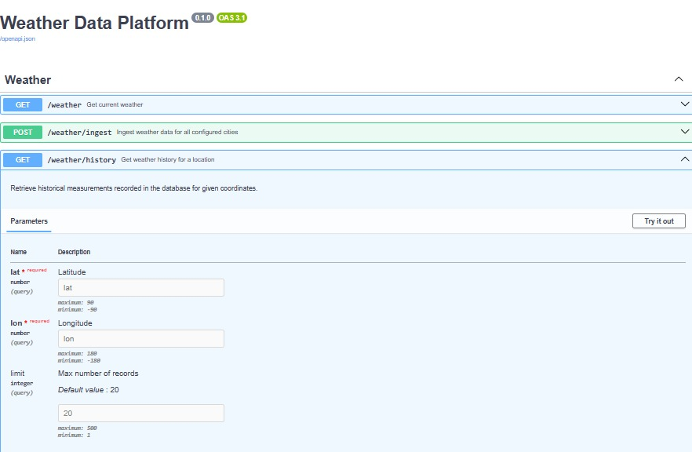
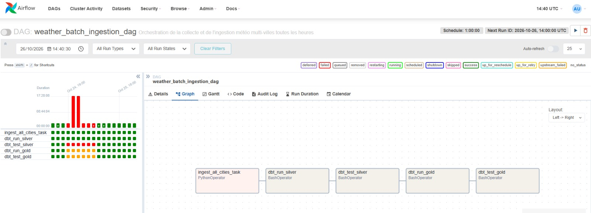
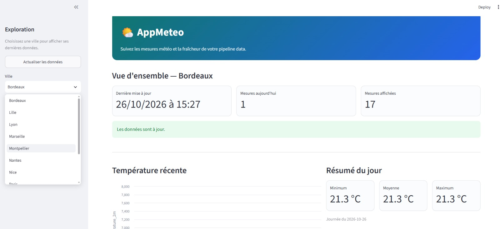

# AppMeteo - Plateforme de données météorologiques

[](https://github.com/DzoBest/appMeteo/actions/workflows/ci.yml)

AppMeteo collecte les données météo d'Open-Meteo, les stocke dans PostgreSQL,
puis les transforme avec dbt. L'application expose une API FastAPI et un DAG
Airflow orchestre l'ingestion périodique des villes configurées.

## Architecture

```text
Open-Meteo
    │
    ▼
FastAPI ──► PostgreSQL (public.weather_measurements / couche Bronze)
    ▲
    │ POST /weather/ingest
    │
Airflow (DAG horaire)
    │
    ▼
dbt ──► silver.silver_weather ──► gold.mart_daily_weather_summary
```

## Aperçu de la plateforme

Quelques vues de l'application et de son pipeline de données :

### API REST — Swagger UI

L'API FastAPI expose une documentation OpenAPI interactive avec les endpoints
de consultation, d'ingestion et d'historique météo.



### Orchestration — Airflow

Le DAG Airflow exécute séquentiellement l'ingestion, les transformations dbt
Silver et Gold, ainsi que leurs tests de qualité.



### Visualisation — Dashboard Streamlit

Le dashboard permet de sélectionner une ville, de suivre la fraîcheur des
données, de visualiser les températures récentes et de consulter les agrégats
journaliers Gold.



Le dépôt contient les principaux composants suivants :

```text
src/appmeteo/                 API, services, repositories et modèles SQLModel
dags/weather_ingestion_dag.py DAG Airflow d'ingestion multi-villes
transform_meteo/              Projet dbt et modèle Silver
tests/                        Tests de l'API
dashboard/                    Interface Streamlit de visualisation
.github/workflows/ci.yml      Workflow GitHub Actions de tests automatisés
docker-compose.yml            PostgreSQL, API et services Airflow
```

### Fonctionnalités

- API REST FastAPI documentée avec Swagger et ReDoc.
- Collecte unitaire pour des coordonnées GPS et enregistrement automatique en
  base.
- Ingestion batch des 11 villes du référentiel par défaut, avec trois
  requêtes Open-Meteo simultanées et une reprise automatique en cas de
  limitation temporaire :
  Paris, Marseille, Lyon, Toulouse, Nice, Nantes, Strasbourg, Montpellier,
  Bordeaux, Lille et Rouen.
- Stockage des mesures dans PostgreSQL avec :
  - les colonnes structurées (`city_name`, `temperature_2m`,
    `relative_humidity_2m`, `weather_code`, `recorded_at`, etc.) ;
  - le payload Open-Meteo complet dans `raw_payload` au format JSONB.
- DAG Airflow `weather_batch_ingestion_dag`, exécuté toutes les heures, avec
  deux tentatives de reprise et un délai de cinq minutes entre les tentatives.
- Modèle dbt `silver_weather` matérialisé en incrémental :
  - lit `public.weather_measurements` ;
  - conserve les mesures dont la température et l'humidité sont renseignées ;
  - exclut les mesures sans `city_name` afin de garantir la qualité de la
    couche analytique ;
  - ne traite, après le premier lancement, que les mesures dont l'identifiant
    Bronze est supérieur au maximum déjà présent dans la table cible, afin de
    conserver toutes les villes lors d'une ingestion parallèle ;
  - vérifie les colonnes `city_name`, `temperature_2m` et `recorded_at` avec
    des tests `not_null`.
- Modèle dbt Gold `mart_daily_weather_summary`, matérialisé en table dans le
  schéma PostgreSQL `gold`, avec les agrégats journaliers par ville
  (température moyenne, minimale, maximale, humidité moyenne et nombre de
  mesures).
- Dashboard Streamlit interactif permettant de :
  - sélectionner une ville parmi celles disponibles dans la couche Silver ;
  - consulter la date de la dernière mise à jour, le nombre de mesures du jour
    et le nombre de mesures affichées ;
  - visualiser les 48 dernières températures sous forme de graphique ;
  - consulter le résumé du jour et l'historique journalier issus de la couche
    Gold ;
  - être averti lorsque les données ont plus de trois heures et actualiser les
    données à la demande.

## Prérequis

- [Docker Desktop](https://www.docker.com/) et Docker Compose ;
- un clone local de ce dépôt : les dossiers `dags/`, `plugins/` et
  `transform_meteo/` sont indispensables au fonctionnement d'Airflow et de
  dbt ;
- pour le développement local : Python 3.12 ou supérieur et
  [uv](https://docs.astral.sh/uv/) ;
- pour exécuter dbt hors conteneur : dbt Core avec l'adaptateur PostgreSQL et
  un profil `transform_meteo` configuré dans `~/.dbt/profiles.yml`.

## Démarrage avec Docker Compose

Le projet doit être cloné avant de démarrer les services. L'image seule ne
suffit pas : Docker Compose monte les dossiers locaux `dags/`, `plugins/` et
`transform_meteo/` dans les conteneurs Airflow. Sans ces dossiers, Airflow ne
trouve pas le DAG et dbt ne trouve pas `dbt_project.yml` ni ses modèles.

```bash
git clone <URL_DU_DEPOT>
cd appMeteo
```

Le démarrage lance PostgreSQL, l'API FastAPI, le dashboard Streamlit et
Airflow avec une image Airflow locale contenant `dbt-core` et `dbt-postgres` :

```bash
copy transform_meteo\profiles.yml.example transform_meteo\profiles.yml
docker compose up -d --build
```

Les dossiers suivants sont montés automatiquement par Docker Compose :

| Dossier du projet | Chemin dans Airflow | Utilisation |
| --- | --- | --- |
| `dags/` | `/opt/airflow/dags` | DAGs Airflow |
| `plugins/` | `/opt/airflow/plugins` | Plugins Airflow |
| `transform_meteo/` | `/opt/airflow/transform_meteo` | Projet dbt et profil |
| `logs/` | `/opt/airflow/logs` | Logs Airflow |

Le fichier `transform_meteo/profiles.yml` est ignoré par Git. Il lit les
paramètres de connexion dans les variables `DBT_DB_HOST`, `DBT_DB_PORT`,
`DBT_DB_USER`, `DBT_DB_PASSWORD`, `DBT_DB_NAME`, `DBT_DB_SCHEMA` et
`DBT_THREADS`, fournies aux conteneurs Airflow par `docker-compose.yml`.
Adaptez ces variables si les identifiants PostgreSQL changent.

Vérifier l'état des services :

```bash
docker compose ps
docker compose logs -f api
```

Les interfaces sont disponibles aux adresses suivantes :

| Service | URL |
| --- | --- |
| API | <http://127.0.0.1:8000> |
| Swagger UI | <http://127.0.0.1:8000/docs> |
| ReDoc | <http://127.0.0.1:8000/redoc> |
| Dashboard Streamlit | <http://127.0.0.1:8501> |
| Airflow | <http://127.0.0.1:8080> |

Le compte Airflow de développement est initialisé par `airflow-init`. Les
identifiants définis dans `docker-compose.yml` doivent être remplacés avant
toute utilisation dans un environnement partagé ou de production.

### Utiliser le dashboard météo

Ouvrir <http://127.0.0.1:8501> après le démarrage des services, puis
sélectionner une ville dans la barre latérale. Le dashboard affiche :

- la dernière mise à jour et le nombre de mesures disponibles pour la ville ;
- un état de fraîcheur indiquant si les dernières données datent de plus de
  trois heures ;
- un graphique des 48 dernières températures de la couche Silver ;
- les températures minimale, moyenne et maximale du dernier jour disponible ;
- l'historique journalier Gold, incluant l'humidité moyenne et le nombre de
  mesures.

Le bouton **Actualiser les données** vide le cache du dashboard et recharge les
données depuis PostgreSQL. Les données récentes sont mises en cache pendant
60 secondes et la liste des villes pendant 5 minutes.

Arrêter les services sans supprimer les données :

```bash
docker compose down
```

Réinitialiser également le volume PostgreSQL :

```bash
docker compose down -v
```

## API

### Consulter la météo actuelle

`GET /weather` accepte une latitude et une longitude. Les valeurs par défaut
sont `49.4432` et `1.0993`.

```bash
curl "http://127.0.0.1:8000/weather?lat=48.8566&lon=2.3522"
```

La réponse est enregistrée dans `public.weather_measurements` et contient les
conditions actuelles renvoyées par Open-Meteo.

### Déclencher une ingestion batch

```bash
curl -X POST http://127.0.0.1:8000/weather/ingest
```

La réponse indique le nombre de villes effectivement ingérées. Les erreurs de
collecte d'une ville sont isolées des autres collectes.

Le DAG Airflow appelle ce même endpoint via le réseau Docker :

```text
http://api:8000/weather/ingest
```

### Consulter l'historique

```bash
curl "http://127.0.0.1:8000/weather/history?lat=48.8566&lon=2.3522&limit=20"
```

`limit` vaut 20 par défaut et accepte une valeur comprise entre 1 et 500.
L'historique est renvoyé du relevé le plus récent au plus ancien.

### Vérifier l'état de l'application

```bash
curl http://127.0.0.1:8000/
```

## Développement local

Installer les dépendances :

```bash
uv sync
```

Démarrer uniquement PostgreSQL avec Compose :

```bash
docker compose up -d db
```

Puis lancer l'API :

```bash
uv run fastapi dev
```

La variable `DATABASE_URL` peut être définie dans un fichier `.env` pour
remplacer la valeur par défaut. Le fichier `.env` est ignoré par Git.

## Transformations dbt

Le projet dbt se trouve dans `transform_meteo/`. Il doit utiliser la même base
PostgreSQL que l'API et disposer d'un profil nommé `transform_meteo`.

En local, créer d'abord le profil à partir de l'exemple :

```bash
copy transform_meteo\profiles.yml.example transform_meteo\profiles.yml
```

Depuis le répertoire du projet dbt, avec dbt installé localement :

```bash
cd transform_meteo
dbt debug
dbt run
dbt test
```

Dans le DAG Airflow, les tâches sont exécutées dans une chaîne unique :

```text
ingest_all_cities_task
  >> dbt_run_silver
  >> dbt_test_silver
  >> dbt_run_gold
  >> dbt_test_gold
```

Ainsi, une erreur d'ingestion bloque toutes les transformations dbt, et une
erreur de test Silver empêche de construire Gold. Le modèle incrémental est
construit depuis la table Bronze `public.weather_measurements`. Une exécution
complète peut être demandée lorsqu'une reconstruction de la table Silver est
nécessaire :

```bash
dbt run --full-refresh
```

Après la correction du filtre incrémental de Silver, exécuter une fois
`dbt run --full-refresh` pour récupérer les mesures éventuellement ignorées par
les anciennes exécutions. Les lancements suivants peuvent reprendre le
traitement incrémental normal.

## Tester le DAG et vérifier les tables

Après `docker compose up -d --build` :

1. Ouvrir Airflow sur <http://127.0.0.1:8080> et se connecter avec le compte
   de développement `admin` / `admin`.
2. Ouvrir le DAG `weather_batch_ingestion_dag`, puis l'onglet **Graph**.
   Le graphe doit afficher l'ingestion suivie de `dbt_run_silver`,
   `dbt_test_silver`, `dbt_run_gold` et `dbt_test_gold`.
3. Déclencher le DAG avec **Trigger DAG**. Attendre que les cinq tâches soient
   vertes. En cas d'échec, consulter les logs de la tâche concernée avant de
   relancer.
4. Vérifier les tables produites dans PostgreSQL :

```bash
docker exec -it appmeteo_db psql -U appmeteo -d appmeteo -c "SELECT COUNT(*) AS bronze_count FROM public.weather_measurements;"
docker exec -it appmeteo_db psql -U appmeteo -d appmeteo -c "SELECT COUNT(*) AS silver_count FROM silver.silver_weather;"
docker exec -it appmeteo_db psql -U appmeteo -d appmeteo -c "SELECT * FROM gold.mart_daily_weather_summary ORDER BY metric_date DESC, city_name ASC LIMIT 15;"
```

Les commandes dbt peuvent aussi être diagnostiquées dans le conteneur
Scheduler :

```bash
docker compose exec airflow-scheduler bash -lc "cd /opt/airflow/transform_meteo && dbt debug"
```

## Inspection de PostgreSQL

Afficher les dernières mesures :

```bash
docker exec -it appmeteo_db psql -U appmeteo -d appmeteo -c "SELECT id, city_name, temperature_2m, relative_humidity_2m, recorded_at FROM public.weather_measurements ORDER BY id DESC LIMIT 15;"
```

Afficher la structure de la table Bronze :

```bash
docker exec -it appmeteo_db psql -U appmeteo -d appmeteo -c "\d public.weather_measurements"
```

Après une exécution dbt, vérifier les tables Silver et Gold :

```bash
docker exec -it appmeteo_db psql -U appmeteo -d appmeteo -c "SELECT * FROM silver.silver_weather ORDER BY recorded_at DESC LIMIT 15;"
```

```bash
docker exec -it appmeteo_db psql -U appmeteo -d appmeteo -c "SELECT * FROM gold.mart_daily_weather_summary ORDER BY metric_date DESC, city_name ASC LIMIT 15;"
```

## Tests

Lancer la suite de tests Python :

```bash
uv run pytest
```

Les tests couvrent notamment la validation des coordonnées et les réponses de
l'API en cas de succès ou d'indisponibilité d'Open-Meteo.

## Intégration continue avec GitHub Actions

Le workflow [ci.yml](.github/workflows/ci.yml) s'exécute automatiquement à
chaque `push` et à chaque Pull Request. Il :

1. démarre un PostgreSQL 16 temporaire ;
2. installe Python 3.12 et les dépendances verrouillées avec `uv` ;
3. initialise les tables SQLModel de la base de test ;
4. exécute `uv run pytest`.

Pour reproduire localement les tests :

```bash
uv sync --frozen
uv run pytest
```

La CI utilise une base PostgreSQL temporaire indépendante de la base Docker
locale. Le badge en haut du README indique l'état du dernier workflow.
